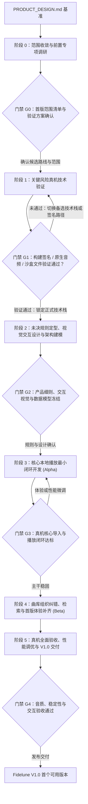

# Fidelune 首版（V1.0）完整实施计划

本文档基于 `PRODUCT_DESIGN.md`（第一轮产品设计基准）制定，覆盖 Fidelune 从当前产品构想到 **iOS 首个可用版本（V1.0 个人本地音乐完整闭环）** 的全流程实施路径。文档面向发起人决策与后续多 Agent 接续执行，确保阶段清晰、风险前置、边界严明、结果可验。

---

## 1. 计划目标与核心工程原则

### 1.1 终点定义

交付运行于 iPhone / iOS 的 **首个可用版本（V1.0）**：在纯客户端、无自建后端、无自有账号的边界内，支持个人自用及小范围群友稳定完成本地音乐从 **获取、组织到高保真播放** 的完整日常闭环，并为后续扩展个人远程连接、合规第三方服务集成及 Android / Windows 平台保留清晰演进边界。

### 1.2 核心实施原则

1. **致命风险最先验证**：在锁死架构、展开视觉设计或投入业务编码之前，优先以最小真机原型验证「无 Mac 条件下的 iOS 编译签名与调试」「iOS 原生高保真音频输出」「iOS 沙盒媒体目录与外部文件访问」三大全局性风险。
2. **成熟技术优先复用**：音频解码、系统音频会话、文件访问、本地数据库、标签解析等基础设施优先复用成熟开源库与平台原生能力；自研工作严格聚焦于产品逻辑、曲库组织纠错与聆听交互。
3. **最小闭环渐进扩展**：先跑通「本地导入—基础资料库与专辑联动—高保真播放」最小可用骨架，再按确认后的首版清单增量叠加深度组织、索引纠错、检索与附属信息，拒绝大爆炸式开发与过度工程化。
4. **严守基准与显式门禁**：严格区分首版范围与长期愿景，不擅自修改已确定的产品规则；对存在不确定性的技术路线与待讨论的产品交界设立显式决策门禁（Decision Gate），不提前锁定缺乏实测或用户确认依据的方案。

---

## 2. 产品边界与范围基线

### 2.1 全局不可违背红线（所有阶段与 Agent 强制遵守）

| 维度 | 已确定的刚性约束（源自 `PRODUCT_DESIGN.md`） |
| --- | --- |
| 运行与账号 | 纯客户端本地运行，无自建后端，无 Fidelune 账号。 |
| 声音还原 | 以原生采样率和位深为默认目标，避免播放器主动重采样；**排除自定义音效、PEQ 和混响**。 |
| 产品纯粹性 | **排除评论、交友、社交等泛娱乐模块**及促消费/延长停留功能；**本地不做自主推荐或聆听统计**。 |
| 文件与元数据安全 | 原生元数据不可编辑；曲库组织、索引纠错与删除操作仅作用于应用索引，**绝不改写音频文件元数据，也绝不删除用户原始音频文件**。 |
| 纠错与生命周期 | 疑似误识别专辑仅提供候选与确认操作，**猜测结果本身绝不自动删除条目**；删除记录须跨重扫持久化并支持误删恢复，与可一键清理的临时媒体缓存保持独立生命周期。 |
| 播放上下文 | **取消独立管理的临时播放队列**，播放范围严格由发起播放时的上下文视图决定。 |
| 平台优先级 | iPhone / iOS 优先（发起人无 Mac 开发环境）；macOS 当前不在范围内。 |

### 2.2 首版范围与长期愿景四象限划分

依据 M6「先在 iOS 做成个人本地音乐的完整使用闭环，暂不接入第三方服务」及「待讨论的首版边界」，将全量能力划分为四类，防止范围蔓延或擅自裁剪：

| 分类 | 包含模块与能力 | 在本计划中的处理策略 |
| --- | --- | --- |
| **A 类：已确定首版核心骨架** | iOS 客户端载体；「资料库 / 音乐 / 设置」一级导航与每页顶部搜索框（默认首页「音乐」可改）；本地应用媒体目录与外部文件访问及 iOS 卸载风险提醒；以专辑为核心的资料库、内置不可删「收藏」歌单、最近 500 首「播放历史」系统歌单；M3.3 资料库收录、专辑部分/完整视图展示与上下文播放联动；常规播放模式（顺序/随机/列表循环/单曲循环）；播放恢复（默认记曲目开头，可改为记秒数）；高保真无损解码与优先原生规格输出（有线避重采样、蓝牙随系统协商）；原生内嵌歌词/曲目信息/专辑介绍读取；全局小播放器与完整播放页基础能力。 | **首版必做**，在阶段 3 优先贯通核心闭环。 |
| **B 类：首版待确认弹性边界** | ① **本地深度组织与附属细项**：原生专辑疑似错误识别与逐项/一键候选删除、文件夹自设专辑及自动同步、分类自动识别与手动/文件夹分类及长按曲目多选类别（`n ≥ 1`）、删除记录恢复界面、自定义歌单与歌单内调序、外部歌词导入、筛选与排序具体清单、音频链路参数展示、临时缓存（256 MB～8 GB 可调 + 一键清理）在纯本地阶段的启用范围。 ② **跨边界延伸候选**：「其他连接」（个人网盘/远程持有文件成熟连接）、跨设备不可访问灰显与成熟 Wi-Fi 跨设备文件读取、组织成果同步/导出备份、Wi-Fi 音频与外接 DAC 扩展适配。 | **不在计划中擅自拍板**，统一纳入 **门禁 `G0`**（及依赖实测的 **`G1` / `G2`**）由发起人确认归入 V1.0（阶段 4 实施）还是延后至 V1.x（建议默认将跨边界延伸候选延至 V1.x，确保 V1.0 聚焦本地闭环）。 |
| **C 类：长期产品愿景** | 第三方合规流媒体服务集成与原服务账号授权；多来源同名音乐识别呈现、发行/录音版本区分与跨来源收藏归属；第三方服务自带推荐与统计承接；Android 与 Windows 客户端开发及桌面/安卓独占输出适配。 | **首版明确不做**，仅在阶段 2 数据模型中预留轻量来源标识字段，避免未来重构数据库，不编写任何超前业务代码。 |
| **D 类：明确排除项** | 自定义音效/PEQ/混响、评论/交友/社交模块、独立临时播放队列、原生元数据修改、本地自主推荐与听歌统计、自建服务端与自有账号、macOS 端、付费宣传与独立网站。 | **严格排除**，任何阶段均不设计、不实现。 |

---

## 3. 阶段划分总览与依赖拓扑

全周期划分为 **6 个阶段（阶段 0 ～ 阶段 5）** 与 **5 个关键决策/准出门禁（`G0` ～ `G4`）**。

| 阶段 | 阶段名称 | 核心关注点 | 前置依赖 | 关键门禁 |
| --- | --- | --- | --- | --- |
| **阶段 0** | 范围收敛与前置专项调研 | 硬件/账号条件摸底、无 Mac 构建签名与技术栈调研、质量标准制定、首版范围初定 | `PRODUCT_DESIGN.md` | `G0`：首版范围与验证方案确认 |
| **阶段 1** | 关键风险技术验证与技术选型 | 真机验证「无 Mac 编译签名」「iOS 原生音频输出」「iOS 沙盒与外部目录访问」，锁定技术栈 | 阶段 0 通过 `G0` | `G1`：技术可行性与正式选型定案 |
| **阶段 2** | 未决规则定型、视觉交互与架构建模 | 冻结全部首版待讨论规则、完成 M4 视觉调研与缺失参考图交互重建、设计轻量数据模型 | 阶段 1 通过 `G1` | `G2`：产品规格、UI 与数据契约冻结 |
| **阶段 3** | 核心本地播放最小闭环开发 | 正式工程与 CI 固化，贯通「本地导入—基础资料库与专辑联动—高保真播放」端到端主干 | 阶段 2 通过 `G2` | `G3`：真机最小可用闭环里程碑 |
| **阶段 4** | 曲库组织纠错、检索与首版体验补齐 | 按确认的首版清单实现纠错与恢复、自设专辑、多分类、歌单调序、搜索筛选、歌词与设置 | 阶段 3 通过 `G3` | 功能完备准出检查 |
| **阶段 5** | 真机全面验收、性能调优与首版交付 | 对照质量标准进行音质、杂乱曲库、稳定性与性能验收，修复缺陷并发布 V1.0 | 阶段 4 完成 | `G4`：首个可用版本（V1.0）发布 |

---

## 4. 分阶段详细实施计划

### 阶段 0：范围收敛与前置专项调研

- **阶段目标**：盘点发起人真实设备与签名客观条件，完成无 Mac 构建分发路径、候选技术栈及可判定质量标准的案头调研，并与发起人对齐首版（V1.0）功能边界清单。
- **前置依赖**：`PRODUCT_DESIGN.md` 已就绪。
- **任务范围**：
  - `P0-T1` **客观开发与测试基线盘点**：向发起人确认测试 iPhone 型号与 iOS 系统版本、Windows 主机与手机连接条件（USB / 局域网）、Apple ID 或 Apple Developer Program 具备情况、常用测试音频规格（如不同采样率/位深的 FLAC、ALAC、WAV 等及真实杂乱标签样本）与常用输出设备（有线转接头/外接 DAC、蓝牙耳机、Wi-Fi 音频接收设备）。
  - `P0-T2` **无 Mac 条件下 iOS 编译、签名与真机调试调研（对应 M5/M6）**：评估云端 macOS 编译环境（如 GitHub Actions 开源/私有额度与单次构建耗时）及合规真机安装路径（付费开发者账号 TestFlight / Ad-Hoc 分发 vs 免费 Apple ID 配合成熟自签名侧载工具供个人与群友自签安装；明确将未落实的企业签名排除在依赖前提之外），并梳理无本地 Xcode 时的真机日志提取与崩溃诊断方案。
  - `P0-T3` **客户端候选技术栈对比调研（对应 M5 未选定项）**：围绕「成熟方案复用」「Windows 本地开发与自测效率（降低无 Mac 云端等待成本）」「iOS 原生高保真音频与沙盒桥接控制力」「启动速度与大列表性能」「未来向 Android / Windows 演进成本」五个维度，评估 2～3 套候选路线（如跨平台 UI 框架配合薄层 iOS 原生音频/文件模块 vs 纯原生方案），拟定进入阶段 1 真机实测的首选与备选组合，不在此阶段主观锁死结论。
  - `P0-T4` **可判定的音质、播放稳定性与交互质量标准调研（对应 M6 待调研）**：将质量目标转化为可客观检验的验收指标，涵盖：无损还原判定方法（音源规格与系统输出会话规格一致性核验、零应用层主动重采样验证、切歌平顺无爆音）、播放稳定性指标（后台驻留、锁屏控制、来电/闹钟/耳机拔插中断恢复、连续长时播放、损坏文件容错跳过）、性能与交互响应指标（冷启动耗时、千/万首级曲库扫描与列表滑动帧率、点击起播响应耗时）。
  - `P0-T5` **首版（V1.0）范围清单收敛（对应 M6 待讨论首版边界）**：针对 2.2 节 B 类弹性项提供实现成本与依赖分析，建议采用「V1.0 聚焦纯本地完整获取—组织—播放闭环，跨边界连接与跨设备能力归入 V1.x」的务实方案，交由发起人逐项勾选确认（与平台能力强相关的细项允许标记「待阶段 1 实测后最终拍板」）。
- **决策节点 `G0`（首版范围与验证路线门禁）**：
  - 发起人确认《首版 V1.0 功能范围清单》；
  - 确认阶段 1 真机验证所采用的签名路径与首选候选技术栈。
- **阶段交付物**：
  - `docs/research/IOS_BUILD_SIGN_RESEARCH.md`（无 Mac 构建、签名、分发与真机调试调研报告）
  - `docs/research/TECH_STACK_COMPARISON.md`（客户端框架、音频引擎、数据库与解析库候选对比报告）
  - `docs/standards/QUALITY_BENCHMARKS.md`（音质、播放稳定性与交互质量可判定验收标准）
  - `docs/specs/V1_SCOPE_MATRIX.md`（经确认的首版 V1.0 与后续版本范围划分表）
- **进入下一阶段条件**：
  - 上述 4 份交付文档完备并获发起人确认；测试真机与签名账号前置条件就绪；阶段 1 实测用例清单明确。

---

### 阶段 1：关键风险技术可行性验证与正式技术选型

- **阶段目标**：构建极简验证原型（Spike PoC，不含正式业务界面），在真实 iPhone 上逐一跑通三大核心技术风险，以实测数据驱动正式技术选型，杜绝带着未验证假设进入大规模开发。
- **前置依赖**：阶段 0 完成且通过门禁 `G0`。
- **任务范围**：
  - `P1-T1` **无 Mac 云端编译、签名与真机交付闭环实测**：初始化代码版本库与远端构建连接（当前工作区尚未初始化 Git），搭建最小自动化构建脚本，跑通「Windows 提交代码 -> 云端 macOS 编译打包 IPA -> 签名并安装到测试 iPhone -> 真机运行并回传诊断日志/崩溃信息」全流程，记录端到端构建耗时与群友分发可操作性。
  - `P1-T2` **iOS 原生高保真音频输出与系统控制实测（对应 M2.3/M5/M6）**：在原型中播放多规格无损测试音频（覆盖常见无损格式及 44.1kHz～192kHz / 16bit～24bit 等不同规格），实测有线/外接小尾巴 DAC、本机扬声器、蓝牙及 Wi-Fi（系统 AirPlay）下的音频会话表现；验证播放器层不主动重采样；摸清 iOS 系统接口在各输出路径下**真实可读取**与**无法获取**的链路参数边界；验证后台播放、锁屏媒体中心联动与音频中断恢复。
  - `P1-T3` **iOS 应用媒体目录与外部文件访问边界实测（对应 M2.2/M2.4）**：实测应用容器媒体目录在 iOS「文件」App 中的暴露配置、大批量音频拷入与扫描性能、系统「卸载应用」与「删除应用」对容器内媒体的实际影响；实测外部文件夹安全书签（Security-Scoped Bookmark）跨应用重启的持久访问能力、云盘未下载占位文件识别，以及目录文件增删变动的检测方式（前台快照增量比对 vs 系统监听）。
  - `P1-T4` **（条件触发）附加高风险边界验证**：仅当发起人在 `G0` 明确将「其他连接」或特定传输协议纳入 V1.0 时，补充对应成熟协议库的最小真机读取验证；若按默认建议聚焦纯本地闭环则跳过。
  - `P1-T5` **实测复盘与正式技术栈定案**：汇总三大验证结果，正式选定开发语言、客户端 UI 框架、音频解码与输出方案、元数据与歌词解析库、本地持久化数据库及支持的文件格式清单。
- **决策节点 `G1`（关键风险与技术选型门禁）及分支预案**：
  - **若构建或签名链路受阻**：评估切换备选签名分发方式（如免费侧载工具切换或启用开发者账号 TestFlight）；在稳定打通「Windows -> 云端构建 -> 真机运行与日志回收」之前，**禁止进入阶段 2 与阶段 3**。
  - **若跨平台音频库存在重采样或链路控制受限**：保留高效率跨平台业务/UI 层，将音频播放与 `AVAudioSession` 控制封装为独立的薄层 iOS 原生模块；若框架整体启动或列表渲染性能无法满足 `QUALITY_BENCHMARKS.md`，则切换阶段 0 备选技术栈重验。
  - **若 iOS 沙盒限制后台监控外部文件夹变更**：将 M2.2「文件夹自设专辑自动同步」的同步时机明确限定为「应用启动、切回前台或进入对应视图时执行增量目录扫描 + 手动刷新兜底」，同步移交阶段 2 写入产品规则。
- **阶段交付物**：
  - 独立分支或验证目录中的最小真机 PoC 源码及可复现 CI 配置
  - `docs/verification/PHASE1_POC_REPORT.md`（真机技术可行性实测报告，含各设备音频输出实测表、可读链路参数表、沙盒目录行为结论）
  - `docs/architecture/TECH_STACK_DECISION.md`（正式技术选型决策文档 ADR）
- **进入下一阶段条件**：
  - 真机成功运行验证包，无损音频输出、后台稳定性与文件访问均满足基础红线；无悬而未决的平台可行性盲区；正式技术栈获发起人确认。

---

### 阶段 2：首版未决规则定型、交互视觉设计与轻量化架构建模

- **阶段目标**：依据阶段 1 实测的平台客观能力，协同发起人逐项敲定首版所有「待讨论」产品与交互规则，完成 M4 视觉风格调研与界面规范制定（补齐原对话中 5 张不可读参考图片的信息空白），并完成克制、可扩展的架构与数据建模。
- **前置依赖**：阶段 1 完成且通过门禁 `G1`。
- **任务范围**：
  - `P2-T1` **首版未决产品规则全量拍板（输出结构化选项与推荐默认值供发起人确认）**：
    1. **M3.4 资料库与专辑联动四大规则交界**：「听过」的量化判定标准（完播比例/秒数阈值，按单曲计还是按专辑计）；已听且整张收藏但无单独收藏曲目时的默认展示及整张收藏与单曲收藏的关系；仅收藏单曲或收藏未听歌单时的资料库收录规则；单纯展开/收起完整专辑视图是否影响已开始的当前播放上下文。
    2. **M2.2 曲库组织细则**（按首版纳入范围）：原生专辑疑似错误识别的判定条件；创建文件夹自设专辑后，未被列为疑似错误的原生专辑共存或归并规则；多分类在专辑层的展示与归属推导规则。
    3. **M2.3 播放与链路参数细则**：从搜索、分类或单曲入口起播时的播放范围定义；重开应用恢复曲目时是否一并恢复原播放范围及确认默认不自动起播；500 首播放历史的删除粒度（单条/多选/清空）与重复收听记录口径（刷新位置 vs 重复追加）；基于 `PHASE1_POC_REPORT.md` 实测结果确定是否展示及如何区分展示「音源规格」与「可读取的输出规格」（无法取得的参数严禁伪标为实际输出）。
    4. **M2.5 & M3.1 搜索、筛选与非首版入口呈现**：明确资料库与音乐页参考 Apple Music 的具体筛选项与排序项清单；明确三个一级页面顶部搜索框的默认范围、设置页搜索对象，以及首版暂不接入第三方服务（及暂缓连接项）时，「个人/非个人/全部」三档切换与「音乐」页「本地/第三方/其他连接」三类入口的界面呈现方式。
    5. **M2.4 存储提醒与临时缓存细则**：确认 iOS 应用媒体目录卸载风险提醒的展示位置与触发节点；确认纯本地首版中临时缓存（256 MB～8 GB 可调 + 一键清理）的具体作用范围（如缩略图派生缓存或外部文件读取缓冲）。
  - `P2-T2` **信息架构与交互细节规范设计（对应 M3.1～M3.3，重建缺失配图细节）**：
    - 明确「资料库」（专辑、歌单[收藏/历史]、分类[含作者]）、「音乐」、「设置」（完整分组与层级深度）页面结构、页面返回栈与滚动位置记忆逻辑。
    - 参考 Apple Music 成熟分工，补齐原对话缺失图片所指向的 **全局小播放器**（底部导航上方布局、封面/曲目信息/播放暂停/下一首及进入完整页手势）与 **完整播放页**（主播放控制视图、歌词视图、输出设备视图、当前播放范围视图的切换交互，严格贯彻无独立临时播放队列原则）。
    - 定型全量操作细节：曲目点击与长按菜单完整项（含自选多类别 `n ≥ 1`）、疑似误识别专辑逐项确认与一键删除候选操作流、删除记录查看与误删恢复操作、歌单内调整自定义曲目顺序交互（如拖拽手柄/编辑模式）、滑动/多选/撤销反馈。
  - `P2-T3` **视觉体系专项调研与设计规范（对应 M4 待调研）**：
    - 围绕「简洁、有层次、避免堆砌、保留必要信息密度与设计表达」及 Apple Music 信息密度/视觉重心参考，调研并确立色彩与明暗主题、封面/文字/控件的视觉层级比例、材质表现、关键转场动效及首版是否提供轻量可个性化视觉属性。
    - 沉淀结构化设计令牌（Design Tokens：字号、间距、色彩语义、圆角、动效时长）及核心页面线框布局说明，供后续开发直接消费。
  - `P2-T4` **轻量化客户端架构与索引持久化设计（对应 M2.4/M5）**：
    - 划分清晰的客户端模块边界：文件与来源适配层、元数据解析与增量扫描层、曲库索引与组织规则层、高保真播放引擎与上下文状态机层、UI 呈现层。在数据实体上保留轻量 `source_type` / `source_uri` 字段解耦本地路径依赖（为长期愿景中的其他连接与第三方服务留口，但**绝不在首版编写超前适配逻辑**）。
    - 设计本地数据库表结构与索引重扫算法：严格分离「只读原生元数据提取层」「用户组织修正层（自设专辑、多分类映射、歌单顺序、收藏、聆听标记）」「跨重扫持久化的删除记录表（Tombstone）」以及「独立目录的临时媒体缓存」，确保重扫与清缓存互不污染。
- **决策节点 `G2`（产品规格、视觉交互与架构契约冻结门禁）**：
  - 发起人审阅并确认全部未决规则决议、播放器及核心页面交互方案、视觉主题方向；冻结首版需求基线，进入编码阶段后不再随意变更核心规则。
- **阶段交付物**：
  - `docs/specs/V1_PRODUCT_RULES.md`（首版未决产品规则逐项定案文档）
  - `docs/specs/UX_INTERACTION_SPEC.md`（信息架构、播放器重构与全套交互细节规范）
  - `docs/specs/VISUAL_DESIGN_SYSTEM.md`（M4 视觉调研结论、界面风格与设计令牌规范）
  - `docs/architecture/DATA_AND_MODULE_DESIGN.md`（客户端模块边界、数据库 Schema 与重扫/纠错/恢复算法设计）
- **进入下一阶段条件**：
  - 归属首版的所有「待讨论」「暂定」「待调研」条目均已转化为无歧义的书面规则与设计规范，并经发起人确认通过门禁 `G2`。

---

### 阶段 3：核心本地播放最小闭环开发

- **阶段目标**：搭建正式客户端工程与自动化构建测试底座，优先贯通「本地音乐导入 -> 元数据扫描入库 -> 资料库收录与专辑联动浏览 -> 高保真上下文播放与状态记忆」最小端到端可用闭环（Alpha）。
- **前置依赖**：阶段 2 完成且通过门禁 `G2`。
- **任务范围**：
  - `P3-T1` **正式工程脚手架、设计令牌接入与 CI 流水线固化**：按 `TECH_STACK_DECISION.md` 与 `DATA_AND_MODULE_DESIGN.md` 初始化正式工程结构，配置静态检查、Windows 本地可运行的领域层单元测试框架及云端 iOS 自动打包签名流水线；落地 `VISUAL_DESIGN_SYSTEM.md` 基础主题样式与公共导航壳。
  - `P3-T2` **本地音乐获取、只读解析与基础索引存储**：实现应用媒体文件夹管理、外部音频文件/目录授权接入、iOS 应用容器卸载风险提醒提示；集成音频元数据、封面及内嵌信息只读解析（严守不改写原文件红线）；完成本地数据库迁移脚本与基础专辑入库、增量重扫逻辑。
  - `P3-T3` **高保真播放引擎与上下文状态机实现**：封装无损音频解码与优先原生采样率/位深输出模块；实现无独立临时队列的上下文播放范围控制、四种常规播放模式（顺序/随机/列表循环/单曲循环）、播放恢复机制（默认记曲目开头，支持切换记忆秒数位置）、最近 500 首播放历史独立记录及 iOS 锁屏/后台播放控制集成。
  - `P3-T4` **三级导航主干、资料库专辑联动与双态播放器界面实现**：实现「资料库」「音乐」「设置」一级导航（含默认首页切换）与顶部搜索框骨架；实现「音乐—本地」文件导入与查看入口；实现「资料库」专辑列表与专辑详情页（完整落地 M3.3 与 `G2` 敲定的未听/已听收藏过滤展示、完整专辑视图切换及对应播放范围联动）、内置「收藏」与「播放历史」系统歌单；实现底部全局小播放器与完整播放页主控制及输出设备视图。
  - `P3-T5` **核心领域测试与首轮真机闭环验证**：为 M3.3/M3.4 资料库专辑联动规则、播放上下文范围、历史记录上限截断及播放恢复编写自动化单元测试；打包 Alpha 真机版本完成端到端实测。
- **决策节点 `G3`（最小可用闭环里程碑检查点）**：
  - 在测试 iPhone 上检验核心获取与播放闭环的真实音质表现、冷启动速度、列表滑动流畅度及播放器操作顺手度；若存在基础体验短板，在本阶段先行收敛修复，再进入阶段 4 扩展开发。
- **阶段交付物**：
  - 正式客户端主干工程代码与自动化构建配置
  - 核心播放与资料库联动状态机单元测试集
  - 可在真机流畅导入并聆听本地专辑的 **Alpha 构建包**及测试记录
- **进入下一阶段条件**：
  - 真机成功跑通「放入/导入本地音频 -> 资料库浏览专辑与收藏 -> 按视图上下文高保真播放 -> 锁屏切歌 -> 重启恢复」全链路；核心单元测试全部通过；无阻断性崩溃或音频重采样异常。

---

### 阶段 4：曲库深度组织、索引纠错、检索与首版体验补齐

- **阶段目标**：在稳固的 Alpha 播放主干之上，严格依据 `V1_SCOPE_MATRIX.md` 与 `V1_PRODUCT_RULES.md` 增量实现首版范围内的曲库纠错、自由组织、搜索筛选、歌词附属信息与设置管理，达成首版功能完备（Beta）。
- **前置依赖**：阶段 3 完成且通过检查点 `G3`。
- **任务范围**（以下子项严格按门禁 `G0` / `G2` 确认纳入首版的清单执行裁剪或全量落地）：
  - `P4-T1` **原生专辑纠错与跨重扫删除恢复闭环**：实现疑似误识别原生专辑的自动检测候选展示、用户逐项确认删除与一键删除候选项（确保猜测本身绝不自动删除条目）；实现独立持久化的删除记录（Tombstone），保证重扫曲库不会重新带回用户已删条目，并提供误删专辑与分类的恢复界面。
  - `P4-T2` **文件夹自设专辑与多维分类管理**：实现按单个文件夹建立自设专辑，并按阶段 1/2 确定的机制自动同步文件夹内容变动；实现分类首次自动识别（作者归入分类）、删除错分或冗余分类、切换手动/沿用文件夹习惯分类，以及长按曲目自选一个或多个类别（`n ≥ 1`）。
  - `P4-T3` **自定义歌单与歌单内排序**：实现自定义歌单增删改（锁定「收藏」歌单不可删除）、歌单内自定义曲目顺序调整交互，以及「播放历史」按确认粒度的删除功能。
  - `P4-T4` **三页检索、筛选排序与歌词/附属信息补齐**：实现三个一级页面顶部搜索框的完整检索逻辑（含三档范围架构及首版界面呈现）、参考 Apple Music 的筛选与排序功能；完善完整播放页的原生内嵌歌词展示、缺失歌词外部导入（附优先推荐内嵌歌词说明）、曲目信息与专辑介绍查看，以及按 `G2` 结论落地可选的音频链路参数展示。
  - `P4-T5` **设置页完善、临时缓存清理与异常边界打磨**：完善设置页全部已定分组（默认首页、恢复到秒数开关、最高无损质量与调整选项、256 MB～8 GB 临时缓存容量滑档与一键清理入口、存储生命周期说明等）；补齐空曲库引导、外部文件暂不可用灰显态、异常音频文件容错跳过提示等细节体验。
  - `P4-T6` **条件选做扩展项（仅当 `G0` 明确纳入首版时执行）**：若发起人在 `G0` 决定将特定个人远程文件连接等弹性项纳入 V1.0，则在此任务中基于成熟协议库接入对应只读来源。
- **阶段交付物**：
  - 首版全功能客户端源码与回归测试套件（重点覆盖：重扫不带回已删项、误删恢复完整性、一键清缓存不伤索引与删除记录、自设专辑同步、多分类映射）
  - 功能齐备的 **Beta 候选测试包**
- **进入下一阶段条件**：
  - `V1_SCOPE_MATRIX.md` 承诺的全部 V1.0 功能开发完毕并通过单元与集成自测；反复执行「重扫曲库」与「一键清理临时缓存」后，用户全部组织成果与删除记录零丢失，原始音频文件零修改。

---

### 阶段 5：真机全面验收、性能调优与首个可用版本交付

- **阶段目标**：严格对照阶段 0 制定的 `QUALITY_BENCHMARKS.md` 与 `PRODUCT_DESIGN.md` 执行真机全场景验收与性能调优，清零关键缺陷，完成首个可用版本（V1.0）打包交付及项目交接文档归档。
- **前置依赖**：阶段 4 完成并产出 Beta 候选测试包。
- **任务范围**：
  - `P5-T1` **高保真音质与多输出链路真机验收**：在有线/外接 DAC、蓝牙耳机、Wi-Fi 音频接收端及本机外放间进行多采样率/位深音源交叉播放测试，逐项核验原生规格输出策略、设备热插拔切换稳定性、锁屏控制与长时间连续播放表现。
  - `P5-T2` **真实复杂曲库压测与数据生命周期核验**：导入发起人真实规模的个人曲库（含分碟杂乱、同专多条目、特殊字符、缺失标签、高分辨率封面、外部授权文件夹混合场景），全流程检验索引纠错、自设专辑、多分类、歌单调序、搜索筛选、缓存清理及卸载提醒准确性。
  - `P5-T3` **启动响应、滑动流畅度与常规能耗优化**：真机剖析冷启动耗时、大图封面列表滚动帧率、大曲库检索延迟与后台播放耗电情况，做针对性优化（严守 M5「不为节省资源牺牲核心体验」原则）。
  - `P5-T4` **V1.0 正式打包分发、用户指引与后续演进归档**：生成正式 V1.0 发布构建包与 Git 版本标签；编写面向个人与小范围 QQ 群用户的安装、签名续期（若采用自签侧载方案）及本地传歌与防丢失说明；整理首版后待办沉淀文档，方便后续 Agent 接手 V1.x 或多平台/多来源迭代。
- **决策节点 `G4`（首个可用版本 V1.0 发布门禁）**：
  - 发起人基于真机日常试听与曲库管理实测确认验收通过，批准发布 V1.0。
- **阶段交付物**：
  - **Fidelune V1.0 正式可分发安装包**及可复现 CI 构建工作流（Tag `v1.0.0`）
  - `docs/verification/V1_ACCEPTANCE_REPORT.md`（首版音质、稳定性、性能与功能全量验收报告）
  - `README.md` 与 `docs/USER_GUIDE.md`（项目开源说明、无 Mac 编译复现指南、群友安装与本地媒体管理说明）
  - `docs/ROADMAP_POST_V1.md`（首版后路线图沉淀：V1.x 延后项、其他连接、第三方合规接入及 Android / Windows 演进指南）
- **阶段完成标准（首版交付终点）**：
  - `QUALITY_BENCHMARKS.md` 全部核心指标达标；阻断性与严重级缺陷清零；发起人在真机确认达到日常主力可用水准；工程与文档满足后续任意 Agent 零上下文接续要求。

---

## 5. `PRODUCT_DESIGN.md` 未决、待调研与待验证事项全量追踪表

为确保无遗漏、不越权，下表将 `PRODUCT_DESIGN.md` 中所有非「已确定」条目逐一映射至实施阶段与决策门禁：

| 来源章节 | 原始状态 | 事项摘要 | 范围归属 | 承接阶段与任务 | 收敛门禁 |
| --- | --- | --- | --- | --- | --- |
| M2.1 | 待讨论 | 多来源同一音乐识别呈现、发行/录音版本区分、收藏指向单来源或跨来源对象、接入哪家第三方服务及授权 | C 类（长期愿景） | 阶段 2 `P2-T4` 仅做主键解耦预留；阶段 5 归入 `ROADMAP_POST_V1.md` | 首版后 |
| M2.2 | 待讨论 | 创建自设专辑后未列为疑似错误的原生专辑如何共存；专辑层的多分类归属规则 | A/B 类（首版组织规则） | 阶段 2 `P2-T1` | `G2` |
| M2.3 | 待讨论 | 搜索/分类/单曲入口起播上下文；重开是否恢复原播放范围与自动起播；历史删除粒度与重复收听口径 | A 类（首版播放规则） | 阶段 2 `P2-T1` | `G2` |
| M2.3 | 待讨论 | 是否及如何展示音频链路参数（区分源规格与实测/可读取输出规格） | B 类（依赖平台实测） | 阶段 1 `P1-T2` 实测可读性 -> 阶段 2 `P2-T1` 拍板 | `G1` -> `G2` |
| M2.3 / M5 / M6 | 待技术验证 | iOS 原生音频输出能力（采样率/位深保持、外接设备与不同协议链路行为） | A 类（核心技术风险） | 阶段 1 `P1-T2` | `G1` |
| M2.4 | 待技术验证 | 应用媒体目录在目标平台（iOS）的可见性、访问与卸载行为；外部文件夹授权与同步边界 | A 类（核心技术风险） | 阶段 1 `P1-T3` | `G1` |
| M2.4 | 待技术验证 | 跨设备 Wi-Fi 访问另一设备文件的可行边界 | B/C 类（视 `G0` 取舍，默认延后） | 阶段 0 `P0-T5` 判定范围；若延后则归入 `ROADMAP_POST_V1.md` | `G0` |
| M2.4 | 待讨论 | 跨设备条目如何到达另一设备；歌单/分类/收藏/自设专辑是否同步、备份或恢复 | B/C 类（长期同步；本地导出备份可在 `G0` 评估） | 阶段 0 `P0-T5` 判定范围；架构留口见阶段 2 `P2-T4` | `G0` / 首版后 |
| M2.4 | 待讨论（工程） | 索引持久化的具体数据结构和算法 | A 类（首版工程核心） | 阶段 2 `P2-T4` 设计 -> 阶段 3/4 实现 | `G2` |
| M2.5 | 暂定 / 待讨论 | 参考 Apple Music 的具体筛选项与排序项清单化；歌单内自定义排序具体操作 | A/B 类（首版交互细则） | 阶段 2 `P2-T1`、`P2-T2` | `G2` |
| M3.1 | 待讨论 | 设置页分组深度与搜索对象、资料库/音乐页搜索默认范围、三档切换呈现及搜索结果布局 | A 类（首版信息架构细则） | 阶段 2 `P2-T1`、`P2-T2` | `G2` |
| M3.2 | 暂定 / 待讨论 | 全局小播放器与完整播放页细节（原 5 张参考图不可读）；点击/长按/滑动/多选/拖拽/撤销/返回与位置记忆及页内布局 | A 类（首版核心交互规范） | 阶段 2 `P2-T2` | `G2` |
| M3.4 | 待讨论 | 「听过」判定标准；已听整张收藏无单曲收藏展示；单曲/未听歌单入库规则；展开收起视图对当前播放的影响 | A 类（首版核心状态机规则） | 阶段 2 `P2-T1` | `G2` |
| M4 | 暂定 / 待调研 | 具体视觉风格、色彩与主题、材质、动效、可个性化视觉属性（参考 Apple Music 信息密度与层次） | A 类（首版视觉规范） | 阶段 2 `P2-T3` | `G2` |
| M5 / M6 | 待技术验证 | 无 Mac 条件下的 iOS 编译、签名与分发（企业签名未落实，不作唯一前提） | A 类（头号生存线风险） | 阶段 0 `P0-T2` 调研 -> 阶段 1 `P1-T1` 真机实测 | `G0` -> `G1` |
| M5 | 待讨论 | 编程语言、框架、数据库、音频引擎和协议选型；扩展与模块边界；具体分发方式 | A 类（首版技术与工程底座） | 阶段 0 `P0-T3` -> 阶段 1 `P1-T5` -> 阶段 2 `P2-T4` | `G1` / `G2` |
| M5 / M6 | 待讨论 / 待验证 | 凭证管理、第三方服务接入验证、长期维护方式 | C 类（第三方属后续开发范围；维护规范在首版交付沉淀） | 阶段 5 `P5-T4` 沉淀维护与后续演进指南 | 首版后 |
| M6 | 待讨论 | 本地闭环逐项包含哪些纠错、分类、歌单、歌词和恢复能力，以及其他连接、跨设备、各输出能力是否纳入首版 | B 类（首版范围边界决策） | 阶段 0 `P0-T5` 初定 -> 阶段 1 实测反馈微调 | `G0`（`G1` 复核） |
| M6 | 待调研 | 可判定的音质、播放稳定性与交互质量标准 | A 类（首版质量基准） | 阶段 0 `P0-T4` 制定 -> 阶段 5 全面检验 | `G0` -> `G4` |
| M6 | 待讨论 | 开发顺序评估 | A 类（整体实施编排） | 本文档已完成阶段与任务排序定义 | 本计划交付 |

---

## 6. 多 Agent 接续工作协议

为保障后续不同会话、不同职责的 Agent（调研 Agent、原型验证 Agent、产品/交互设计 Agent、客户端开发与测试 Agent）无缝协作，特约定以下执行规范：

1. **单一事实来源与文档优先级**
   - 产品原则与长期边界以 `PRODUCT_DESIGN.md` 为基准；未经发起人明确指令，后续 Agent 不得擅自删改 `PRODUCT_DESIGN.md`。
   - 各阶段经发起人拍板的新增结论，必须落盘至本计划第 4 节指定的 `docs/` 交付物路径中。执行优先级依次为：**发起人最新明确修订 > 已通过门禁冻结的阶段规格文档 > `PRODUCT_DESIGN.md`**。
2. **严格门禁准入，禁止跨阶段抢跑**
   - 任何 Agent 接手任务前，须先核查当前所处阶段的前置交付物是否齐全、对应门禁（`G0`～`G4`）是否已获发起人确认。
   - **硬性禁令**：在门禁 `G1`（真机编译签名、原生音频与沙盒文件验证）通过之前，禁止搭建重型正式工程或编写大批量 UI 页面；在门禁 `G2`（首版未决产品规则冻结）通过之前，禁止凭主观臆断在代码中硬编码模糊交界逻辑。
3. **状态交接与任务颗粒度**
   - 后续执行阶段建议以本计划中的任务编号（如 `P0-T1`、`P1-T2`）为单位推进与提交（Git Commit 或阶段记录中标注任务编号）。
   - 每个任务结束时，执行 Agent 应在对应交付文档末尾简要记录：**已完成事项、实测客观结论、遗留待发起人决策点及下一接续任务编号**，确保新 Agent 仅读取仓库文档即可恢复完整上下文。
4. **反过度工程化自检清单（每次架构设计与代码提交前核对）**
   - 是否复用了成熟可靠的解码、存储与系统能力，而非重复造轮子？
   - 是否只实现了当前已确认的首版需求，没有提前编写未启用的第三方接入、复杂插件框架或跨端冗余代码？
   - 是否严格遵守了第 2.1 节的全局红线（零服务端依赖、零元数据篡改、零文件误删、无独立临时队列、无音效/社交/本地统计、删除记录与临时缓存严格隔离）？
